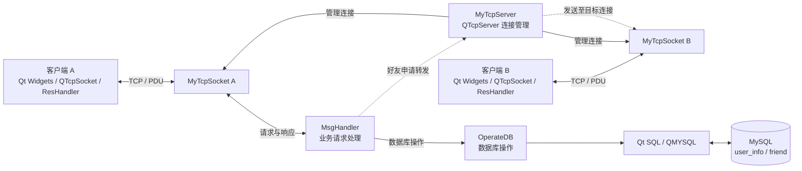

# Qt TCP 聊天客户端/服务端

一个基于 Qt 和 TCP 的客户端/服务端聊天项目。客户端使用 Qt Widgets 构建图形界面，通过 TCP 与服务端通信，并结合 MySQL 管理用户信息、在线状态和好友关系。

目前已实现用户注册登录、在线用户查询和基础好友管理，并搭建了聊天消息的发送与转发流程；聊天体验和文件传输功能仍在完善。

## 技术栈

项目主要使用了哪些技术？

| 领域 | 技术 | 用途 |
| --- | --- | --- |
| 语言 | C++11 | 编写客户端与服务端 |
| 界面 | Qt Widgets、Qt Designer、QSS | 构建客户端图形界面并统一界面样式 |
| 网络 | Qt Network、`QTcpSocket`、`QTcpServer` | 通过 TCP 建立连接并收发数据 |
| 通信协议 | 自定义 PDU | 标记消息类型、长度和消息数据 |
| 数据库 | MySQL、Qt SQL `QMYSQL` 驱动 | 保存用户信息、在线状态和好友关系 |
| 构建 | qmake、MinGW | 管理和构建 Qt 工程 |

## 功能介绍

目前可以完成账号和基础好友操作，界面中的聊天与文件入口仍待接入业务逻辑。

### 已实现

- 用户注册与登录；同一账号在线时，服务端会拒绝重复登录。
- 客户端断开连接后，服务端将该账号的在线状态更新为离线。
- 查询用户在线状态，以及获取在线用户列表。
- 发起好友申请；服务端转发申请，目标用户可以同意或拒绝。
- 阻止用户添加自己；可以刷新在线好友列表或删除好友关系。刷新结果只包含在线好友，离线好友不会显示在列表中。
- 登录页、好友页、文件页和在线用户窗口采用统一的暗紫色 QSS 样式。

### 正在完善

- TCP 收包尚未完善半包、粘包处理；当前收包逻辑假定一次读取能取得完整 PDU。
- 聊天消息已有基础发送与服务端转发流程；发送方消息回显和不同好友会话的隔离仍待完善。文件页面已有界面，上传下载业务尚未接入。
- 好友申请、同意/拒绝、刷新和删除等处理已实现，完整的多客户端流程联调仍待完成。

## 项目架构

客户端负责显示界面、发送请求并处理服务端响应。服务端接收每个客户端的 TCP 连接，根据 PDU 消息类型分发请求；需要读写用户或好友数据时，再通过 Qt SQL 访问 MySQL。



PDU 定义在客户端和服务端各自的 `protocol.h` 中。固定部分由 `uiTotalLen`、`uiMsgLen`、`uiType` 三个 `uint` 字段和 `caData[64]` 组成；可变消息区是 `caMsg[]`，其长度由 `uiMsgLen` 表示。客户端通过 `ResHandler` 处理响应，服务端由 `MsgHandler` 处理业务请求，再调用 `OperateDB` 访问数据库。当前接收逻辑尚未完整处理 TCP 半包和粘包。

## 项目截图

主要功能完善后，将补充客户端登录、好友管理和聊天界面的实际运行截图。

## 项目目录结构

```text
.
├── Client/
│   ├── Client.pro          # 客户端 qmake 工程
│   ├── main.cpp            # 客户端程序入口
│   ├── client.*            # 登录界面、TCP 连接和消息分发
│   ├── protocol.*          # PDU 结构与消息类型
│   ├── reshandler.*        # 服务端响应处理
│   ├── index.*             # 登录后的主界面
│   ├── friend.*            # 好友页及好友操作
│   ├── onlineuser.*        # 在线用户窗口
│   ├── chat.*              # 聊天窗口与基础消息发送
│   ├── file.*              # 文件页界面框架，业务尚未接入
│   ├── client.qss          # 客户端主题样式
│   ├── config.qrc          # 客户端内嵌资源
│   └── connect.config      # 客户端目标地址与端口
├── Server/
│   ├── Server.pro          # 服务端 qmake 工程
│   ├── main.cpp            # 服务端程序入口
│   ├── server.*            # 服务端启动与监听配置
│   ├── mytcpserver.*       # 接入连接与管理客户端 socket
│   ├── mytcpsocket.*       # 单个客户端连接的收发处理
│   ├── msghandler.*        # 注册、登录、查询和好友请求处理
│   ├── operatedb.*         # MySQL 连接与数据操作
│   ├── protocol.*          # PDU 结构与消息类型
│   ├── database.ini.example # 本地数据库配置示例
│   ├── config.qrc          # 服务端内嵌连接配置
│   └── connect.config      # 服务端监听地址与端口
├── database/
│   ├── init.sql            # 数据库和数据表初始化
│   └── README.md           # 数据库说明
├── docs/
│   └── BUILD.md            # 环境配置、编译与运行指南
├── README.md               # 项目介绍
└── CHANGELOG.md            # 项目开发日志
```

## 运行项目

想在本地运行这个项目？环境准备、数据库初始化、配置和编译步骤已单独整理。

👉 [查看编译与运行指南](docs/BUILD.md)

## 开发日志

想了解项目经历了哪些功能迭代？

👉 [查看完整开发日志](CHANGELOG.md)
