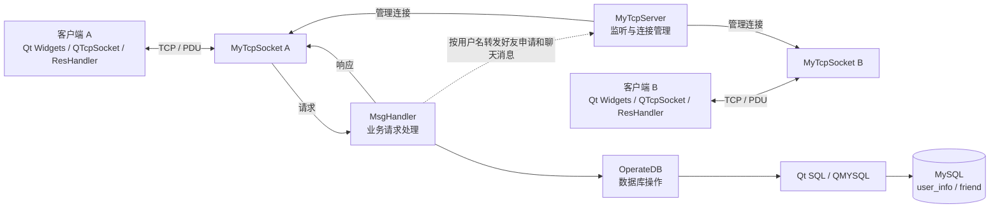
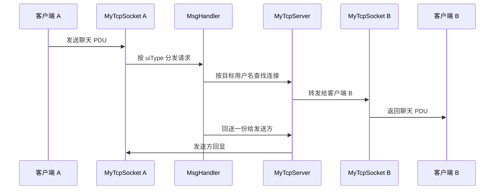
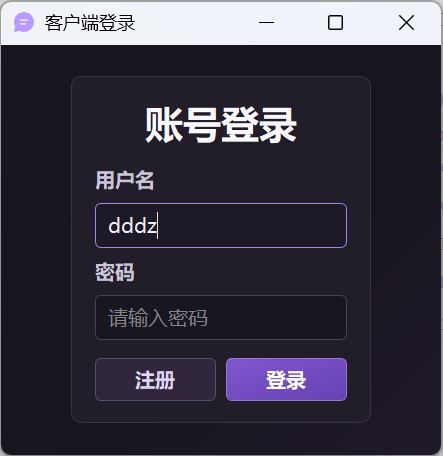
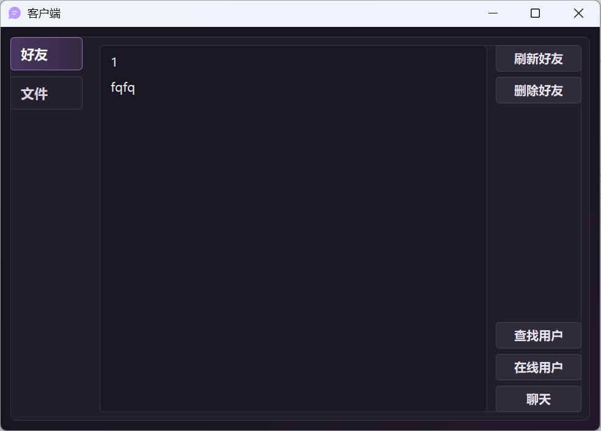
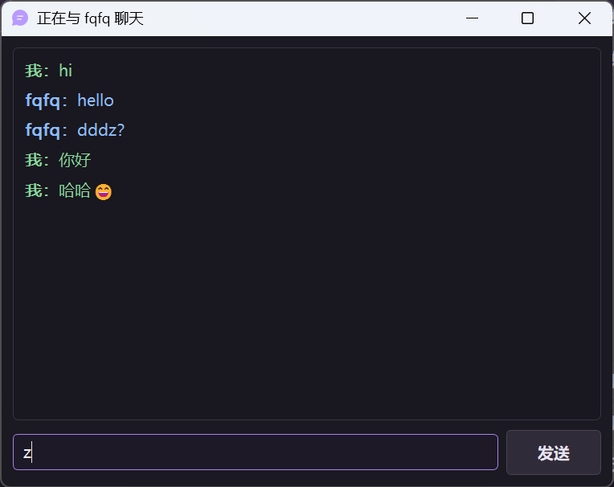
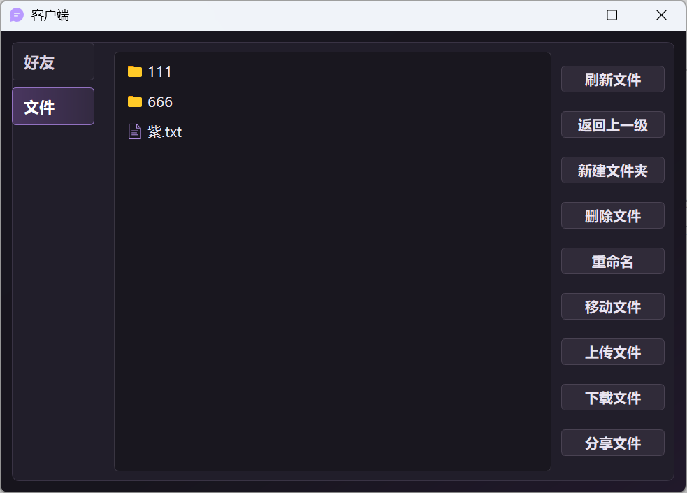

# 基于 Qt 的 TCP 文件管理与即时通信系统

**Qt-based TCP File Management and Instant Messaging System**

一个基于 Qt Widgets、TCP 和 MySQL 的桌面聊天项目。客户端提供账号、好友、聊天和远程文件管理界面；服务端负责处理请求、转发消息，并通过数据库维护用户与好友关系。

目前已接入用户注册登录、好友管理、基础文本聊天，以及远程文件浏览和传输。文件分享、离线消息和服务端聊天记录持久化不在当前实现范围内。

## 技术栈

| 领域 | 技术 | 用途 |
| --- | --- | --- |
| 语言 | C++11 | 编写客户端与服务端 |
| 界面 | Qt Widgets、Qt Designer、QSS | 构建客户端界面并统一样式 |
| 网络 | Qt Network、`QTcpSocket`、`QTcpServer` | 建立 TCP 连接并收发数据 |
| 通信协议 | 自定义 PDU | 区分请求类型、数据长度和消息内容 |
| 数据库 | MySQL、Qt SQL `QMYSQL` 驱动 | 保存用户信息、在线状态和好友关系 |
| 构建 | qmake、MinGW | 管理和构建 Qt 工程 |

## 功能介绍

### 账号与好友

- 用户注册和登录；同一账号在线时拒绝重复登录，客户端断开后更新在线状态。
- 查询用户和在线用户列表。
- 发起好友申请，并处理同意或拒绝；阻止添加自己，支持刷新在线好友和删除好友。

### 聊天

- 服务端将文本消息转发给目标用户，并向发送方回送消息用于即时回显。
- 客户端按好友分别保存和恢复当前运行期间的会话记录，收发消息使用不同文字颜色显示。

### 远程文件

- 浏览目录，刷新列表，新建文件夹、删除、重命名和移动文件。
- 分块上传和下载文件，支持空文件；下载时保留源文件名及扩展名。

## 项目架构

客户端负责界面、请求发送和响应处理。服务端为每个连接创建 `MyTcpSocket`，由 `MsgHandler` 分发业务请求；需要用户或好友数据时通过 `OperateDB` 访问 MySQL。好友申请和聊天消息由服务端根据目标用户名转发到对应连接。



## 核心实现

### 自定义 PDU

客户端和服务端分别在 `protocol.h` 中定义相同的 PDU。固定部分保存长度、类型和参数，可变消息区承载用户名列表、聊天内容或文件数据。

| 字段 | 作用 |
| --- | --- |
| `uiTotalLen` | 当前 PDU 的总长度 |
| `uiMsgLen` | 可变消息区 `caMsg` 的长度 |
| `uiType` | 标识注册、登录、聊天、文件操作等请求或响应类型 |
| `caData[64]` | 固定参数区，例如用户名、操作结果或文件元数据 |
| `caMsg[]` | 可变数据区，例如聊天文本、路径或文件分块 |

TCP 是字节流，单次读取不一定对应一条完整消息。客户端和服务端都将收到的数据追加到缓冲区，再依据 `uiTotalLen` 循环取出完整 PDU，因此具备基础的半包等待和粘包拆分机制。当前对非法长度等异常输入的校验仍需加强。

### 消息转发流程



### 分块文件传输与线程

- 上传先发送目标目录、文件名和文件大小。客户端 `Uploader` 在线程中每次读取 4096 字节，再通过 queued signal 将 PDU 交给客户端的 `sendMsg()`；实际 `QTcpSocket` 写入仍由客户端对象完成。服务端按块写入目标文件，并在传输结束后返回结果。
- 下载先请求文件信息并选择本地保存位置，随后客户端逐块请求数据，服务端每次最多读取 4096 字节，客户端写入本地文件直到完成。
- 上传和下载都按顺序传输数据块；上传读取线程用于减少文件读取对界面的影响，不代表多块并行传输。

## 项目截图

以下截图展示客户端当前的主要界面。

### 登录界面



### 好友管理



### 聊天窗口



### 文件管理



## 项目目录

```text
.
├── Client/                 # Qt Widgets 客户端
│   ├── Client.pro          # 客户端 qmake 工程
│   ├── client.*             # 登录界面、TCP 连接和请求发送
│   ├── reshandler.*         # 服务端响应处理
│   ├── protocol.*           # PDU 和消息类型
│   ├── index.* friend.*     # 主界面与好友管理
│   ├── chat.*               # 聊天窗口和会话记录
│   ├── file.* uploader.*    # 文件管理与分块上传
│   └── client.qss           # 客户端样式
├── Server/                  # Qt TCP 服务端
│   ├── Server.pro           # 服务端 qmake 工程
│   ├── mytcpserver.*         # 监听和连接管理
│   ├── mytcpsocket.*         # 单连接收发与 PDU 分发
│   ├── msghandler.*          # 业务请求处理
│   ├── operatedb.*           # MySQL 操作
│   └── database.ini.example  # 数据库配置示例
├── database/                # 数据库初始化脚本和说明
├── docs/                    # 编译运行指南
├── README.md
└── CHANGELOG.md
```

## 运行项目

想在本地运行这个项目？环境依赖、数据库初始化、连接配置和编译启动步骤已整理在单独的指南中。

👉 [查看编译与运行指南](docs/BUILD.md)

## 开发日志

想了解项目经历了哪些功能迭代？

👉 [查看开发日志](CHANGELOG.md)
